# Azure Retail Lakehouse Platform

Nền tảng Data Engineering end-to-end cho bài toán bán lẻ thương mại điện tử đa nguồn dữ liệu. Dự án kết hợp dữ liệu ERP/CRM dạng batch với clickstream và telemetry IoT từ kho vận, xử lý trên Azure Databricks và Delta Lake, quản trị bằng Unity Catalog, tiếp nhận sự kiện qua Azure Event Hubs và cung cấp data mart cho Power BI.

> **Mục tiêu:** xây dựng một lakehouse demo có thể triển khai theo yêu cầu (on-demand), dễ kiểm thử, có kiểm soát chất lượng dữ liệu và chú trọng tối ưu chi phí.
>
> Dự án được phát triển mới, lấy cảm hứng từ ý tưởng kiến trúc của [NealAnalyticsLLC/Azure-Databricks-Lakehouse](https://github.com/NealAnalyticsLLC/Azure-Databricks-Lakehouse); không sao chép mã pipeline của repository tham khảo. Thiết kế thay DBFS mount kiểu cũ bằng Unity Catalog External Volumes, đồng thời sử dụng Auto Loader, Structured Streaming, Databricks Asset Bundles (DAB), `pytest` và Quality Gates.
---

## Mục lục

- [1. Tổng quan kiến trúc](#1-tổng-quan-kiến-trúc)
- [2. Năng lực kỹ thuật và luồng Medallion](#2-năng-lực-kỹ-thuật-và-luồng-medallion)
- [3. Data products](#3-data-products)
- [4. Cấu hình môi trường đã dùng](#4-cấu-hình-môi-trường-đã-dùng)
- [5. Chuẩn bị máy Windows](#5-chuẩn-bị-máy-windows)
- [6. Chạy thử và kiểm thử local](#6-chạy-thử-và-kiểm-thử-local)
- [7. Triển khai và cấu hình Azure](#7-triển-khai-và-cấu-hình-azure)
- [8. Cấu hình Unity Catalog và storage](#8-cấu-hình-unity-catalog-và-storage)
- [9. Deploy Databricks Asset Bundle](#9-deploy-databricks-asset-bundle)
- [10. Chạy pipeline Batch và Streaming](#10-chạy-pipeline-batch-và-streaming)
- [11. Kiểm tra dữ liệu và Quality Gates](#11-kiểm-tra-dữ-liệu-và-quality-gates)
- [12. Kết nối Power BI Desktop](#12-kết-nối-power-bi-desktop)
- [13. Ảnh minh chứng thực tế](#13-ảnh-minh-chứng-thực-tế)
- [14. Cấu trúc repository](#14-cấu-trúc-repository)
- [15. Bảo mật, chi phí và dọn tài nguyên](#15-bảo-mật-chi-phí-và-dọn-tài-nguyên)
- [16. Xử lý lỗi thường gặp](#16-xử-lý-lỗi-thường-gặp)
- [17. Checklist trước khi push GitHub](#17-checklist-trước-khi-push-github)
- [18. Phạm vi và tài liệu tham khảo](#18-phạm-vi-và-tài-liệu-tham-khảo)

## 1. Tổng quan kiến trúc

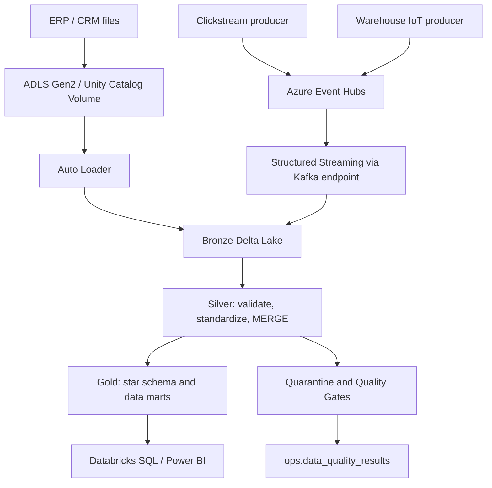

- **Nguồn batch:** các tệp ERP/CRM được tạo bằng generator và chuyển vào vùng landing trên ADLS Gen2.
- **Nguồn sự kiện:** producer gửi clickstream và dữ liệu cảm biến kho vận qua Azure Event Hubs.
- **Bronze:** nạp dữ liệu thô, giữ metadata cần thiết để truy vết nguồn.
- **Silver:** chuẩn hóa kiểu dữ liệu, áp dụng quy tắc kiểm tra, xử lý bản ghi sai và cập nhật dữ liệu theo cách có thể chạy lặp.
- **Gold:** tạo fact, dimension và data mart để phân tích.
- **Orchestration:** Databricks Workflows chạy các job; Databricks Asset Bundles quản lý cấu hình deploy.
- **BI:** Power BI đọc SQL views/data marts từ Azure Databricks.

Streaming dùng `availableNow`: đọc các sự kiện hiện có trong lần chạy rồi dừng compute. Đây là thiết kế cho demo theo yêu cầu, **không phải** streaming liên tục 24/7.

## 2. Năng lực kỹ thuật và luồng Medallion

| Lớp / năng lực | Cách sử dụng trong dự án |
|---|---|
| Cloud & storage | Azure, ADLS Gen2, Access Connector, Storage Credential, External Volumes |
| Ingestion | ERP/CRM batch, Auto Loader, Event Hubs, Structured Streaming qua Kafka endpoint |
| Processing | Python, PySpark, Spark SQL, Delta Lake và Delta `MERGE` |
| Medallion | Bronze → Silver → Gold |
| Modeling | Star schema, fact/dimension, Customer SCD Type 2 |
| Data quality | Contract checks, Quarantine, Quality Gates và lịch sử kiểm định |
| Orchestration | Databricks Workflows và Databricks Asset Bundles |
| Infrastructure | Azure Bicep; Azure Data Factory là tùy chọn |
| Testing & operations | `pytest`, kiểm tra idempotency, checkpoint và Delta maintenance |
| BI | SQL views, Power BI, DAX measures và theme JSON |

### Bronze — tiếp nhận dữ liệu gốc

1. Nạp các tệp batch từ vùng landing bằng Auto Loader.
2. Đọc sự kiện clickstream và telemetry từ Event Hubs.
3. Ghi dữ liệu vào Delta Lake và giữ metadata nguồn cần thiết.

### Silver — chuẩn hóa và kiểm soát chất lượng

1. Chuẩn hóa dữ liệu theo quy tắc trong package và notebooks.
2. Phát hiện dữ liệu sai hợp đồng hoặc không đạt điều kiện kiểm tra.
3. Ghi bản ghi vi phạm vào `ops.quarantine_records`, không âm thầm loại bỏ.
4. Ghi kết quả kiểm tra vào `ops.data_quality_results`.
5. Dùng logic cập nhật phù hợp để tránh tạo bản ghi trùng ngoài ý muốn khi chạy lại.

### Gold — mô hình phân tích

Tạo fact/dimension và các data mart có grain rõ ràng để Power BI dùng lại mà không phải lặp lại toàn bộ logic biến đổi ở mỗi báo cáo.

## 3. Data products

Các tên dưới đây là tên logic trong catalog `retail_dev`. Cần chạy bootstrap và các pipeline tương ứng trước khi kỳ vọng bảng đã tồn tại.

### Gold — dimensional model

- `gold.fact_sales` — fact bán hàng.
- `gold.dim_customer` — dimension khách hàng, có quản lý lịch sử theo SCD Type 2.
- `gold.dim_product` — dimension sản phẩm.
- `gold.dim_date` — dimension ngày.

### Gold — data marts và BI view

- `gold.mart_sales_daily` — tổng hợp bán hàng theo ngày.
- `gold.mart_customer_360` — góc nhìn tổng hợp khách hàng.
- `gold.mart_digital_funnel` — phân tích hành trình số.
- `gold.mart_inventory_health` — theo dõi tình trạng tồn kho.
- `gold.vw_data_quality_latest` — kết quả chất lượng dữ liệu mới nhất.

### Operations & quality

- `ops.quarantine_records` — các bản ghi vi phạm quy tắc dữ liệu.
- `ops.data_quality_results` — lịch sử thực thi Quality Gates.

## 4. Cấu hình môi trường đã dùng

Các tên này được ghi nhận từ lần dựng demo trước; chúng **không đảm bảo tài nguyên vẫn còn tồn tại**. Kiểm tra Azure Portal trước khi chạy lại, đặc biệt vì resource group có thể đã được yêu cầu xóa.

| Hạng mục | Giá trị tham chiếu |
|---|---|
| Azure region | `koreacentral` |
| Resource group | `rg-retail-lakehouse-demo` |
| Databricks workspace | `dbw-retail-dev-rubphn` |
| Storage account | `stretaildevrubphn` |
| Event Hubs namespace | `evhns-retail-dev-rubphn` |
| Key Vault | `kv-retail-dev-rubphn` |
| Databricks CLI profile | `retail-demo` |
| Unity Catalog metastore | `metastore_azure_koreacentral` |
| Catalog | `retail_dev` |
| Logical schemas | `bronze`, `silver`, `gold`, `ops` |
| Storage credential | `retail_dev_storage_credential` |
| Secret scope | `retail-secrets` |
| Databricks Runtime tham chiếu | `16.4.x-scala2.12` |
| Job compute tham chiếu | `Standard_D4s_v3`, 4 vCPU, 16 GB RAM |
| Local development | Windows PowerShell, Python 3.11, Java 17, `.venv` |

SKU phụ thuộc quota và sức chứa tại region. `Standard_D4s_v3` là lựa chọn đã dùng trong demo sau khi một số SKU khác gặp lỗi; đây không phải cam kết rằng SKU luôn được cấp phát.

## 5. Chuẩn bị máy Windows

### 5.1. Phần mềm cần có

- Git.
- Python 3.11.
- Java 17 (JDK).
- Azure CLI nếu triển khai hoặc kiểm tra tài nguyên Azure bằng dòng lệnh.
- Databricks CLI nếu validate/deploy bundle bằng dòng lệnh.
- Power BI Desktop chỉ cần cho phần báo cáo.

Kiểm tra trong **PowerShell**:

```powershell
py -0p
python --version
java -version
git --version
az version
databricks -v
```

Nếu `az` hoặc `databricks` không được nhận diện, mở PowerShell mới hoặc thêm **thư mục cài đặt thực tế** vào PATH. Ví dụ sau chỉ phù hợp nếu CLI của bạn được cài đúng vào các thư mục này:

```powershell
$env:PATH = "D:\Tool_laptrinh\AzureCLI\bin;D:\Tool_laptrinh\DatabricksCLI;$env:PATH"
```

Không đưa đường dẫn máy cá nhân vào script dùng chung nếu người khác sẽ chạy repo trên máy khác.

### 5.2. Mở project

Mở PowerShell tại thư mục gốc repository. Với máy phát triển đã dùng trong demo, đường dẫn là:

```powershell
Set-Location 'D:\Code\project_DE\azure-retail-lakehouse-platform'
```

Nếu repo nằm nơi khác, thay bằng đường dẫn thực tế. Xác nhận đây là thư mục chứa `pyproject.toml`, `generators/`, `src/`, `notebooks/` và `databricks.yml`:

```powershell
Get-ChildItem
```

### 5.3. Tạo môi trường Python

```powershell
py -3.11 -m venv .venv
Set-ExecutionPolicy -Scope Process -ExecutionPolicy Bypass
.\.venv\Scripts\Activate.ps1
python -m pip install --upgrade pip
pip install -e ".[dev,producer]"
```

`Set-ExecutionPolicy` ở trên chỉ áp dụng cho phiên PowerShell đang mở. Nếu lệnh cài package báo không tìm thấy `pyproject.toml`, hãy kiểm tra lại thư mục hiện tại thay vì cài package từ một thư mục bất kỳ.

Để rời môi trường ảo:

```powershell
deactivate
```

## 6. Chạy thử và kiểm thử local

Chạy trong thư mục gốc repo với `.venv` đang active.

### 6.1. Sinh dữ liệu batch mẫu

```powershell
python generators/generate_batch.py --customers 100 --products 30 --orders 300
```

Generator có thể cố ý chèn một số bản ghi sai để thử nghiệm Quarantine. Nếu muốn tắt dữ liệu lỗi, dùng tùy chọn mà script hỗ trợ:

```powershell
python generators/generate_batch.py --customers 100 --products 30 --orders 300 --no-inject-bad-records
```

### 6.2. Kiểm tra producer ở chế độ dry-run

```powershell
python generators/send_events.py --dry-run --events 100
```

`--dry-run` nhằm kiểm tra producer mà không gửi sự kiện thực lên Event Hubs. Muốn xem các tùy chọn được hỗ trợ bởi phiên bản code đang có, chạy:

```powershell
python generators/generate_batch.py --help
python generators/send_events.py --help
```

### 6.3. Kiểm tra repository và chạy test

```powershell
python tools/validate_project.py
pytest -q
```

Nếu cần xem test nào lỗi chi tiết:

```powershell
pytest -v
```

**Cách đọc kết quả:**

- `validate_project.py` dùng để kiểm tra những cấu trúc/quy ước mà tiện ích này được viết để xác nhận.
- `pytest` xác nhận các test trong repository.
- Sinh dữ liệu hoặc dry-run producer thành công **không** chứng minh rằng Azure credentials, Event Hubs hay Databricks job đã hoạt động.

## 7. Triển khai và cấu hình Azure

> **Quan trọng về chi phí:** trước khi triển khai, xác nhận đúng subscription và resource group. Không chạy lệnh xóa hoặc triển khai tài nguyên khi chưa kiểm tra đích.

### 7.1. Đăng nhập và xác nhận subscription

```powershell
az login
az account show --output table
```

Nếu tài khoản có nhiều subscription, chọn subscription đích bằng ID lấy từ Azure Portal/`az account list`:

```powershell
az account list --output table
az account set --subscription '<SUBSCRIPTION_ID>'
az account show --output table
```

Không ghi subscription ID, access token hay secret vào README hoặc commit Git.

### 7.2. Kiểm tra tài nguyên có còn tồn tại không

```powershell
$resourceGroup = 'rg-retail-lakehouse-demo'
az group show --name $resourceGroup --output table
az resource list --resource-group $resourceGroup --output table
```

Nếu lệnh `az group show` báo resource group không tồn tại, dừng tại đây và quyết định có cần tạo lại hạ tầng. Không giả định những ảnh chụp cũ chứng minh tài nguyên vẫn đang chạy.

### 7.3. Triển khai hạ tầng bằng Bicep

1. Mở thư mục `infra/` và tìm file Bicep entry point cùng file tham số thực sự có trong repo.
2. Mở file tham số và kiểm tra region, SKU, tên resource và các giá trị bắt buộc.
3. Xác nhận quota, quyền tạo tài nguyên và chi phí dự kiến trong Azure.
4. Nếu đang dựng một resource group demo mới, hãy tạo đúng resource group đích:

```powershell
az group create --name $resourceGroup --location 'koreacentral'
```

5. Chạy deployment với **đường dẫn và tham số khớp với file thật trong repo**. Mẫu lệnh dưới đây là khung minh họa; thay `<BICEP_ENTRY_FILE>` và `<PARAMETER_FILE>` bằng tên thực tế sau khi kiểm tra `infra/`:

```powershell
az deployment group create `
  --resource-group $resourceGroup `
  --template-file '<BICEP_ENTRY_FILE>' `
  --parameters '@<PARAMETER_FILE>'
```

Không chạy nguyên mẫu placeholder. Nếu repo triển khai hạ tầng theo script/parameter khác, hãy theo đúng định nghĩa đang có trong `infra/`.

### 7.4. Kiểm tra Azure Databricks workspace

Trong Azure Portal, mở workspace đúng resource group rồi lấy **workspace URL** từ phần Overview. Đừng suy đoán URL hay dùng URL của workspace khác.

Có thể kiểm tra bằng Azure CLI nếu quyền đã đủ:

```powershell
az databricks workspace list --resource-group $resourceGroup --output table
```

Nếu workspace, Storage Account hoặc Event Hubs đã bị xóa, cần dựng lại hạ tầng và cấp quyền trước khi tiếp tục những bước sau.

## 8. Cấu hình Unity Catalog và storage

Phần này cần được hoàn tất trước khi chạy bootstrap nếu môi trường Databricks chưa được cấu hình sẵn.

### 8.1. Kiểm tra Unity Catalog

Trong Databricks Catalog Explorer hoặc Account Console:

1. Xác nhận metastore phù hợp với region đã được tạo và gán cho workspace.
2. Xác nhận user/service principal chạy job có quyền sử dụng catalog và schema.
3. Catalog dự kiến của dự án là `retail_dev`; các schema logic là `bronze`, `silver`, `gold`, `ops`.
4. Chạy notebook/job setup catalog theo thứ tự dự án sau khi storage access đã được cấu hình.

### 8.2. Kiểm tra ADLS Gen2 và Access Connector

1. Mở Storage Account đúng tên trong Azure Portal.
2. Xác nhận Data Lake Storage Gen2/Hierarchical Namespace được cấu hình theo yêu cầu dự án.
3. Xác định filesystem/container và các thư mục landing/checkpoint mà bundle hoặc `src/retail_lakehouse/config.py` đang sử dụng.
4. Tìm Access Connector được cấu hình cho Databricks workspace.
5. Cấp quyền managed identity tối thiểu cần thiết lên đúng storage scope. Với đường dẫn cần đọc/ghi, vai trò storage thường dùng cho demo là `Storage Blob Data Contributor`; hãy áp dụng ở scope nhỏ nhất phù hợp với chính sách môi trường.
6. Trong Unity Catalog, xác nhận Storage Credential `retail_dev_storage_credential` trỏ đến Access Connector/managed identity đúng và External Location trỏ tới đường dẫn ADLS Gen2 chính xác.
7. Tạo hoặc kiểm tra External Volumes mà job sử dụng. Không thay bằng DBFS mount `/mnt` nếu mục tiêu là giữ kiến trúc Unity Catalog của dự án.

**Không tự đoán container name hoặc ABFS path.** Hãy kiểm tra cấu hình trong `databricks.yml`, các file dưới `resources/`, notebook `00_setup_catalog.py` và `src/retail_lakehouse/config.py`. Tên storage account đơn lẻ chưa đủ để xác định đầy đủ đường dẫn.

### 8.3. Kiểm tra Event Hubs và secrets

1. Xác nhận Event Hubs namespace đang dùng tier hỗ trợ Kafka endpoint cho cấu hình producer/consumer trong dự án; lần demo tham chiếu namespace Standard.
2. Xác nhận Event Hub entities, consumer group và các tham số trong cấu hình ứng dụng khớp nhau.
3. Đưa connection string/credential vào Key Vault và/hoặc Databricks secret scope `retail-secrets` theo cách repo đang đọc secrets.
4. Không dán secret ra terminal, screenshot, notebook output, issue GitHub hoặc file `.py`.
5. Trước khi gửi event thật, thử `--dry-run` và xem `--help` của producer để hiểu các tùy chọn chính xác trong phiên bản repo.

## 9. Deploy Databricks Asset Bundle

### 9.1. Xác thực Databricks CLI

Sau khi đã cài Databricks CLI, dùng workspace URL lấy từ Azure Portal. OAuth đăng nhập tương tác là cách khởi đầu phù hợp nếu chính sách môi trường cho phép:

```powershell
$env:DATABRICKS_HOST = 'https://<WORKSPACE_HOST>'
databricks auth login --host $env:DATABRICKS_HOST --profile retail-demo
databricks auth profiles
databricks auth describe --profile retail-demo
```

Thay `<WORKSPACE_HOST>` bằng host thật, không thêm path notebook hoặc SQL HTTP path. Nếu profile `retail-demo` đã tồn tại, xác nhận host và identity trong `auth describe` trước khi dùng. CLI hiện đại có thể lưu OAuth token bằng hệ thống lưu trữ credential của Windows.

Nếu tổ chức buộc phải dùng PAT, xử lý token như mật khẩu: không paste vào mã nguồn, không commit `.databrickscfg`, giới hạn thời hạn/quyền và thu hồi khi không còn sử dụng. Ưu tiên phương thức xác thực được tổ chức phê duyệt.

### 9.2. Kiểm tra bundle configuration

Tại thư mục gốc repo, xác nhận file `databricks.yml` tồn tại và đọc target `dev`, biến môi trường, đường dẫn notebook, job resources, cấu hình cluster và nơi tạo wheel package.

```powershell
databricks bundle validate -t dev
```

Nếu lệnh validate báo biến bắt buộc còn thiếu, hãy đặt giá trị đúng trong cấu hình/biến môi trường theo cách mà `databricks.yml` định nghĩa. Không chèn credentials trực tiếp vào bundle.

### 9.3. Deploy bundle

Chỉ deploy sau khi xác nhận profile và workspace đích:

```powershell
databricks bundle deploy -t dev
```

Sau khi deploy, mở Databricks Workflows/Jobs để xác nhận jobs đã được tạo. Bundle chỉ đưa cấu hình và artifacts lên workspace; nó không chứng minh pipeline đã hoàn thành.

## 10. Chạy pipeline Batch và Streaming

Thực hiện theo thứ tự để tránh chạy job phụ thuộc vào schema/volume chưa tồn tại.

### 10.1. Chạy `retail_bootstrap`

1. Vào Databricks workspace → Workflows/Jobs.
2. Tìm job `retail_bootstrap` đã deploy.
3. Xem task parameters, compute, output và log trước khi chạy.
4. Chạy job và đợi toàn bộ task kết thúc trạng thái thành công.
5. Vào Catalog Explorer xác nhận catalog/schema và volume đã được tạo đúng.

Nếu bootstrap thất bại, kiểm tra quyền Unity Catalog, Storage Credential, External Location/Volumes và các đường dẫn storage trước khi chạy batch.

### 10.2. Sinh và đưa dữ liệu batch lên landing

Sinh bộ dữ liệu nhỏ ở local:

```powershell
python generators/generate_batch.py --customers 100 --products 30 --orders 300
```

Sau đó:

1. Đọc log generator và kiểm tra thư mục output mà script thông báo.
2. Mở `src/retail_lakehouse/config.py`, `databricks.yml` và cấu hình resources để tìm **đúng landing path**.
3. Tải file vào External Volume/ADLS Gen2 đã cấu hình. Có thể dùng Azure Storage Explorer hoặc giao diện/CLI phù hợp với quyền của bạn.
4. Xác nhận file xuất hiện ở đúng landing location trước khi chạy job.

Không upload vào một thư mục tùy ý: Auto Loader chỉ đọc path được pipeline cấu hình.

### 10.3. Chạy `retail_batch_pipeline`

1. Mở job trong Workflows.
2. Xác nhận nguồn batch và tham số environment.
3. Run job và kiểm tra từng task, không chỉ nhìn trạng thái tổng.
4. Mở các bảng Bronze/Silver/Gold để xác nhận số lượng bản ghi và timestamp phù hợp.
5. Chạy batch lần thứ hai với cùng đầu vào để kiểm tra tính idempotent; so sánh counts/keys trước và sau, không chỉ dựa vào trạng thái “Succeeded”.
6. Mở `ops.quarantine_records` nếu generator đã tiêm bản ghi không hợp lệ.

### 10.4. Gửi sự kiện và chạy `retail_stream_pipeline`

Trước tiên kiểm tra tùy chọn của producer:

```powershell
python generators/send_events.py --help
python generators/send_events.py --dry-run --events 100
```

Sau khi xác nhận secret, Event Hub, event format và các tham số producer đã cấu hình đúng, mới gửi event thật bằng các tùy chọn mà `--help` liệt kê. Không sử dụng lệnh gửi thật nếu chưa biết rõ đích và credential được dùng.

Tiếp theo:

1. Xác nhận producer đã gửi sự kiện và không để lộ thông tin xác thực trong log.
2. Chạy `retail_stream_pipeline` trong Databricks Workflows.
3. Theo dõi task Bronze streaming, Silver/Gold và Quality Gates.
4. Vì dùng `availableNow`, job kết thúc sau khi xử lý phần dữ liệu có sẵn tại thời điểm chạy. Job dừng khi hoàn tất là hành vi dự kiến, không nhất thiết là lỗi.
5. Nếu cần chạy lại, kiểm tra checkpoint và semantics của pipeline trước. Không xóa checkpoint chỉ để ép chạy lại, vì có thể làm thay đổi cách đọc lại sự kiện.

## 11. Kiểm tra dữ liệu và Quality Gates

### 11.1. Kiểm tra bảng

Mở Databricks SQL Editor hoặc notebook có quyền đọc catalog `retail_dev`. Thực hiện các truy vấn kiểm tra cơ bản:

```sql
SHOW SCHEMAS IN retail_dev;
SHOW TABLES IN retail_dev.bronze;
SHOW TABLES IN retail_dev.silver;
SHOW TABLES IN retail_dev.gold;
SHOW TABLES IN retail_dev.ops;
```

Sau khi xác nhận bảng tồn tại, có thể kiểm tra số lượng dòng:

```sql
SELECT COUNT(*) FROM retail_dev.ops.quarantine_records;
SELECT COUNT(*) FROM retail_dev.ops.data_quality_results;
SELECT COUNT(*) FROM retail_dev.gold.fact_sales;
```

Nếu tên bảng chưa tồn tại, xác nhận job bootstrap và pipeline liên quan đã chạy; không tạo bảng rỗng thủ công chỉ để làm query hết lỗi.

### 11.2. Đọc kết quả Quality Gates

- Mở bảng `ops.data_quality_results` và xem run/timestamp, check name, trạng thái và thông tin liên quan mà schema thực tế cung cấp.
- Mở `ops.quarantine_records` để xem reason/error metadata của bản ghi bị cách ly.
- So sánh kết quả với điều kiện trong `src/retail_lakehouse/quality.py`, `src/retail_lakehouse/transformations.py` và các notebook.
- Đọc `gold.vw_data_quality_latest` nếu view đã được tạo.

Tên cột chi tiết phụ thuộc schema hiện tại trong repo; dùng `DESCRIBE TABLE retail_dev.ops.data_quality_results` và `DESCRIBE TABLE retail_dev.ops.quarantine_records` trước khi viết query theo cột cụ thể.

### 11.3. Chạy SQL views cho Power BI

Mở `sql/10_bi_views.sql` trong Databricks SQL Editor và chạy các câu lệnh theo thứ tự. Kiểm tra từng view đã tạo thành công và truy vấn được trước khi mở Power BI.

## 12. Kết nối Power BI Desktop

### 12.1. Chuẩn bị nguồn dữ liệu

1. Xác nhận các job đã tạo dữ liệu Gold và SQL views đã được chạy.
2. Trong Azure Databricks, mở SQL Warehouse hoặc compute được phép kết nối BI.
3. Mở **Connection details** và sao chép đúng **Server Hostname** và **HTTP Path**. Hai giá trị này phải thuộc endpoint mà tài khoản của bạn được phép truy cập.
4. Xác nhận identity dùng cho Power BI có quyền truy vấn các bảng/views cần thiết.

### 12.2. Kết nối từ Power BI Desktop

1. Mở Power BI Desktop.
2. Chọn **Home → Get data → Azure Databricks** (tên hiển thị có thể thay đổi nhẹ theo phiên bản connector).
3. Nhập **Server Hostname** và **HTTP Path** đã sao chép từ Databricks; không tự ghép HTTP Path.
4. Chọn chế độ kết nối **Import** cho demo này nếu muốn tải dữ liệu vào model Power BI.
5. Chọn phương thức xác thực được tổ chức cho phép và đăng nhập. Bản demo trước dùng PAT làm phương án kết nối trong trường hợp đăng nhập OAuth bằng tài khoản cá nhân bị hạn chế. PAT là bí mật, không lưu trong README, file `.pbix` chia sẻ hoặc ảnh chụp.
6. Trong Navigator, chọn các views/marts phù hợp, sau đó **Load**.
7. Nếu refresh thất bại, quay lại phần Data source settings để kiểm tra host, HTTP path, credential còn hạn và quyền truy cập.

### 12.3. Thiết lập model quan hệ

Trong Model view:

- Dùng `gold.fact_sales` làm bảng fact chính.
- Tạo quan hệ dimension → fact theo khóa surrogate tương ứng (`*_sk`).
- Cardinality thông thường là **One-to-many (1:*)** từ dimension đến fact.
- Dùng **Single** cross-filter direction trừ khi có yêu cầu mô hình rõ ràng cần cách khác.
- Tránh tạo quan hệ many-to-many hoặc bật lọc hai chiều chỉ để làm visual hiện số.
- Kiểm tra kiểu dữ liệu cột key và tránh nối trực tiếp theo tên hiển thị nếu có surrogate key.

### 12.4. Theme, DAX và trang báo cáo

1. Để dùng theme, trong Power BI Desktop mở **View → Themes → Browse for themes** và chọn `bi/theme.json` nếu file có trong repository.
2. Nếu import theme báo JSON/schema error, mở file và xác nhận đó là JSON hợp lệ, lưu **UTF-8 không BOM**, bỏ dấu phẩy thừa và chỉ dùng các thuộc tính được schema theme hỗ trợ.
3. Mở `bi/measures.dax`, tạo từng measure qua **Modeling → New measure** và điều chỉnh tên bảng/cột theo model đã load nếu cần.
4. Tạo visual từ các Gold marts/views. Kiểm tra slicer, kiểu dữ liệu số/ngày, aggregation và quan hệ model.
5. Nếu sử dụng ảnh nền riêng cho trang báo cáo, chọn ảnh thật có trong repo, đặt page canvas theo tỷ lệ 16:9 và điều chỉnh Transparency/fit trong Format page; không tham chiếu file đã bị xóa.

## 13. Ảnh minh chứng thực tế

Các ảnh dưới đây là ảnh chụp từ lần demo trước. Chúng chứng minh trạng thái hiển thị **tại thời điểm chụp**, không chứng minh các tài nguyên Azure vẫn còn hoạt động hiện nay.

<table>
  <tr>
    <td width="50%" valign="top"><strong>1. Azure resources</strong><br/>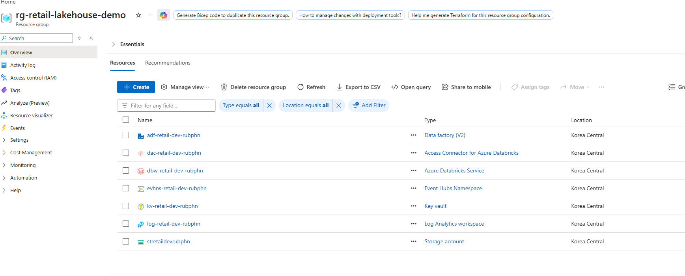<br/>Tài nguyên Azure được nhìn thấy trong resource group lúc chụp.</td>
    <td width="50%" valign="top"><strong>2. Batch workflow</strong><br/>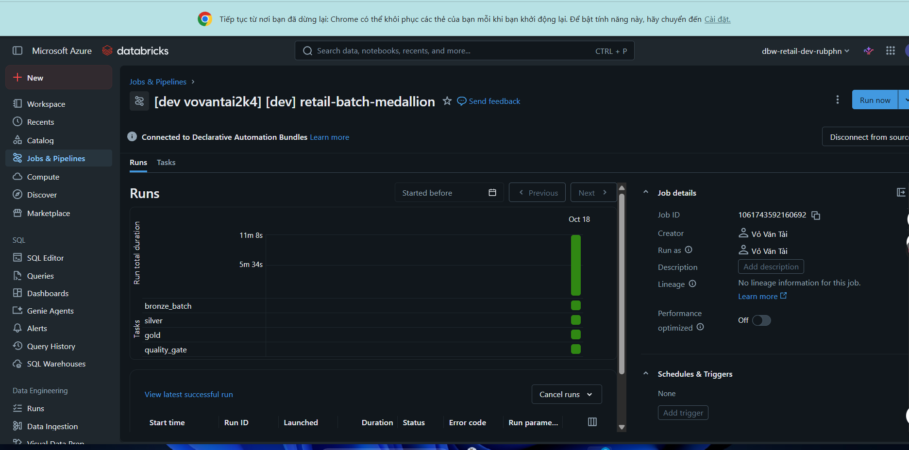<br/>Workflow xử lý dữ liệu batch.</td>
  </tr>
  <tr>
    <td width="50%" valign="top"><strong>3. Streaming workflow</strong><br/>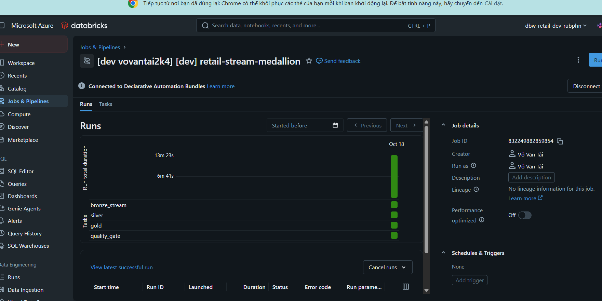<br/>Workflow streaming theo chế độ on-demand.</td>
    <td width="50%" valign="top"><strong>4. Unity Catalog</strong><br/>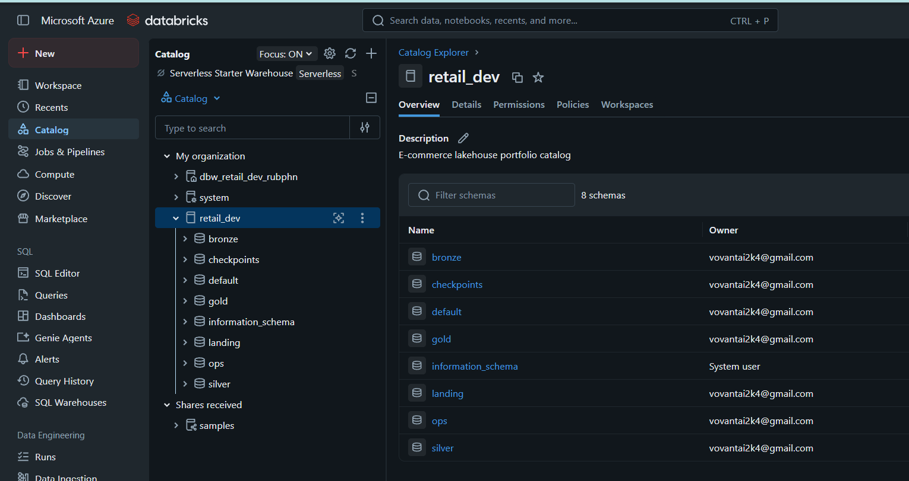<br/>Catalog Explorer và các schema hiển thị.</td>
  </tr>
  <tr>
    <td width="50%" valign="top"><strong>5. Bronze source data</strong><br/>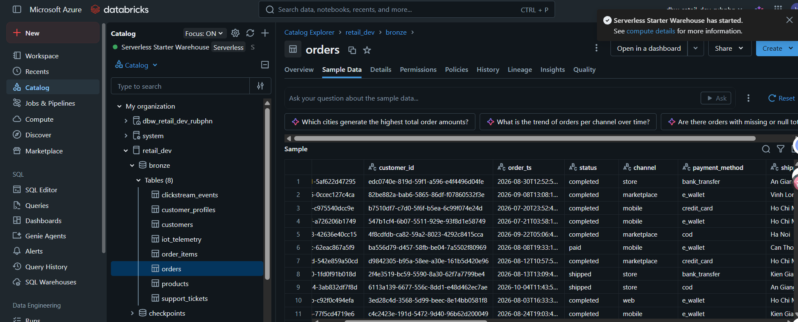<br/>Bảng dữ liệu nguồn trong Bronze.</td>
    <td width="50%" valign="top"><strong>6. Quarantine</strong><br/>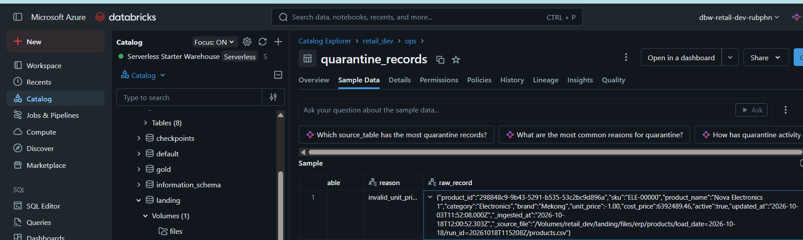<br/>Bản ghi được giữ lại để điều tra lỗi dữ liệu.</td>
  </tr>
  <tr>
    <td width="50%" valign="top"><strong>7. Data quality history</strong><br/>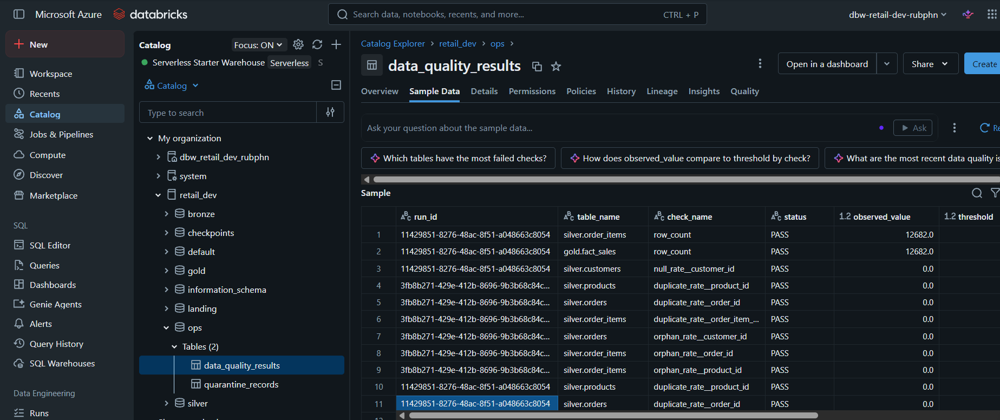<br/>Bảng kết quả kiểm định chất lượng dữ liệu.</td>
    <td width="50%" valign="top"><strong>8. Gold star schema lineage</strong><br/>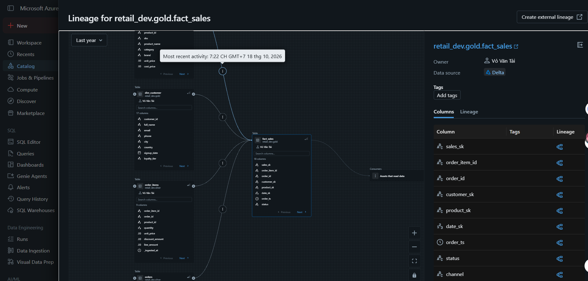<br/>Lineage của bảng fact và các dimension.</td>
  </tr>
  <tr>
    <td width="50%" valign="top"><strong>9. Power BI model view</strong><br/>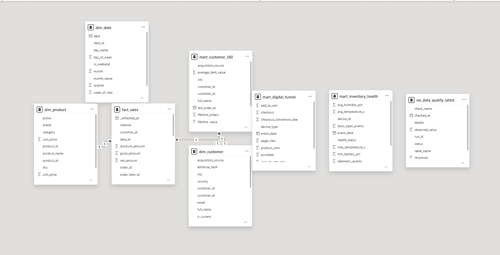<br/>Mô hình bảng trong Power BI Desktop.</td>
    <td width="50%" valign="top"><strong>10. Power BI executive dashboard</strong><br/>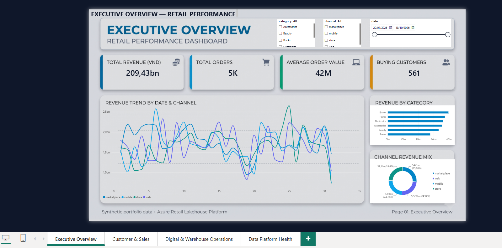<br/>Trang Executive Overview.</td>
  </tr>
  <tr>
    <td width="50%" valign="top"><strong>11. Cost/budget view</strong><br/>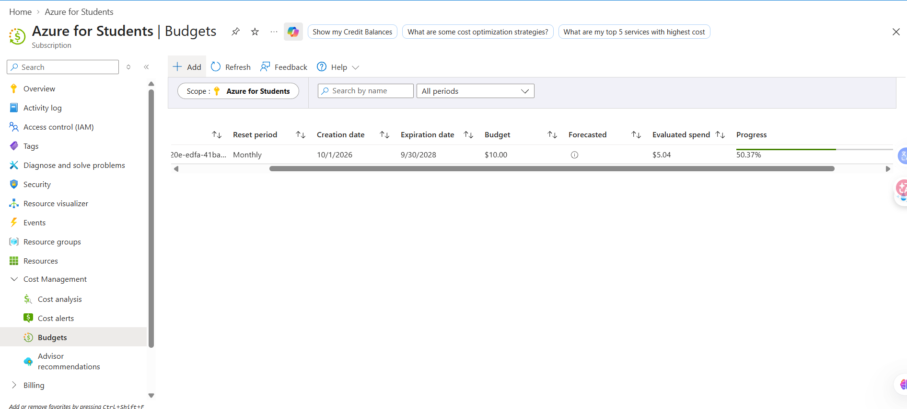<br/>Màn hình Cost Management/Budgets.</td>
    <td width="50%" valign="top"><strong>12. Cleanup command</strong><br/>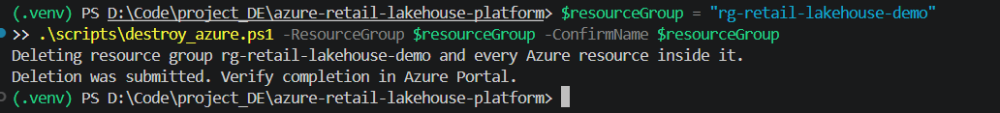<br/>Ảnh terminal cho thấy yêu cầu xóa resource group đã được gửi; cần xác minh trạng thái cuối trên Azure Portal.</td>
  </tr>
</table>

## 14. Cấu trúc repository

```text
infra/                  # Bicep triển khai hạ tầng Azure; Data Factory tùy chọn
generators/              # Generator ERP/CRM và Event Hubs producer
notebooks/               # 7 notebook xử lý Medallion
src/retail_lakehouse/    # Package Python: config, delta utilities, quality, transformations
resources/               # Cấu hình Databricks Asset Bundles / Workflow jobs
sql/                     # SQL views cho BI
bi/                      # DAX, theme và asset thiết kế Power BI (nếu có)
data/contracts/          # Hợp đồng dữ liệu đầu vào
tests/                   # Unit tests
tools/                   # Công cụ kiểm tra cấu trúc/cấu hình
anh/                     # 12 ảnh minh chứng của lần demo trước
```

Notebook chính:

- `00_setup_catalog.py`
- `01_bronze_batch.py`
- `02_bronze_stream.py`
- `03_silver.py`
- `04_gold.py`
- `05_quality.py`
- `06_maintenance.py`

Các file thường cần kiểm tra khi cấu hình: `pyproject.toml`, `databricks.yml`, `src/retail_lakehouse/config.py`, `src/retail_lakehouse/quality.py`, `src/retail_lakehouse/transformations.py`, `resources/` và `sql/10_bi_views.sql`.

## 15. Xử lý lỗi thường gặp

| Lỗi / hiện tượng | Nguyên nhân hay gặp | Cách xử lý |
|---|---|---|
| `py -3.11` không chạy | Python 3.11 chưa cài hoặc launcher chưa nhận diện | Chạy `py -0p`; cài Python 3.11 hoặc chọn interpreter đúng. |
| `Activate.ps1 cannot be loaded` | PowerShell execution policy | Trong phiên hiện tại chạy `Set-ExecutionPolicy -Scope Process -ExecutionPolicy Bypass`, rồi activate lại. |
| `az` / `databricks` not recognized | CLI chưa cài hoặc PATH chưa đúng | Xác nhận vị trí cài; thêm đúng thư mục vào PATH và mở PowerShell mới. |
| `databricks auth`/bundle lỗi xác thực | Profile sai host, đăng nhập hết hạn hoặc identity thiếu quyền | Chạy `databricks auth profiles`, `databricks auth describe --profile retail-demo`, đăng nhập lại và kiểm tra quyền workspace. |
| `CLOUD_PROVIDER_RESOURCE_STOCKOUT` / `SkuNotAvailable` | SKU không còn sức chứa ở region hoặc quota không phù hợp | Kiểm tra quota và SKU có sẵn tại region; không thay SKU ngẫu nhiên. `Standard_D4s_v3` là lựa chọn tham chiếu của lần demo nhưng vẫn phải kiểm tra. |
| `INVALID_PARAMETER_VALUE` khi tạo compute | SKU/thuộc tính cluster không được API hỗ trợ hoặc cấu hình sai | Kiểm tra `node_type_id`, runtime và cấu hình cluster trong bundle; validate lại trước deploy. |
| Unity Catalog không đọc/ghi được ADLS | Access Connector, Storage Credential, External Location hoặc grants chưa đúng | Xác nhận managed identity, role assignment ở storage scope, đường dẫn ABFS và grants UC. |
| `Path does not exist` khi chạy batch | File upload sai landing path hoặc biến cấu hình sai | Kiểm tra log generator, External Volume và path thực tế trong config/bundle. |
| Event Hubs không nhận/gửi được event | Secret/namespace/entity/Kafka endpoint không khớp hoặc quyền thiếu | Kiểm tra namespace, event hub name, credential/secret scope và cấu hình producer/consumer; không in secret ra log. |
| Streaming run xong nhưng không có dòng mới | Chưa gửi event, sai source path/offset hoặc `availableNow` không có dữ liệu mới | Xác nhận producer thực sự gửi event, xem logs và checkpoint; job tự kết thúc sau phần dữ liệu hiện có là bình thường. |
| Bảng Silver/Gold chưa tồn tại | Chưa chạy bootstrap hoặc job phụ thuộc bị lỗi | Chạy theo thứ tự: bootstrap → nạp nguồn → batch/stream → Silver/Gold/quality. Xem task logs. |
| `SyntaxError` ở đầu Databricks notebook `.py` | Header lint nằm trước cell magic `# MAGIC %md` làm Databricks hiểu sai cell đầu | Kiểm tra đầu notebook; không đặt `# ruff: noqa: F821` trước cell magic. Nếu hiện diện, loại bỏ header gây xung đột rồi deploy lại notebook. |
| Power BI không kết nối được | Host/HTTP Path sai, credential hết hạn hoặc chưa có quyền | Copy lại Server Hostname và HTTP Path từ Databricks Connection details; kiểm tra auth và quyền đọc views. |
| `theme.json` không import được | JSON sai schema, dấu phẩy thừa hoặc UTF-8 BOM | Lưu JSON hợp lệ bằng UTF-8 không BOM và dùng thuộc tính theme hợp lệ. |
| `git push` đưa nhầm dữ liệu/secret | `.gitignore` chưa đủ hoặc file đã được track | Kiểm tra `git status`, `git diff --cached` và lịch sử trước khi push; nếu secret đã commit, thu hồi/rotate ngay. |

## 16. Phạm vi và tài liệu tham khảo

Đây là portfolio/reference implementation, không phải hệ thống production 24/7. Trước khi dùng production cần bổ sung theo yêu cầu tổ chức: private endpoints, quản trị danh tính theo nhóm, tách biệt môi trường, khóa do khách hàng quản lý, disaster recovery, SLA/SLO, monitoring/alerting và compute policy có tính sẵn sàng cao.

Tài liệu chính thức để xác minh thay đổi về công cụ và giao diện:

- [Azure Databricks — Medallion architecture](https://learn.microsoft.com/azure/databricks/lakehouse/medallion)
- [Unity Catalog](https://learn.microsoft.com/azure/databricks/data-governance/unity-catalog/)
- [Databricks CLI authentication](https://learn.microsoft.com/azure/databricks/dev-tools/cli/authentication)
- [Databricks Asset Bundles](https://learn.microsoft.com/azure/databricks/dev-tools/bundles/)
- [Auto Loader với Unity Catalog](https://learn.microsoft.com/azure/databricks/ingestion/cloud-object-storage/auto-loader/unity-catalog)
- [Azure Event Hubs Kafka endpoint](https://learn.microsoft.com/azure/event-hubs/azure-event-hubs-apache-kafka-overview)
- [Power BI với Azure Databricks](https://learn.microsoft.com/azure/databricks/partners/bi/power-bi)

---
