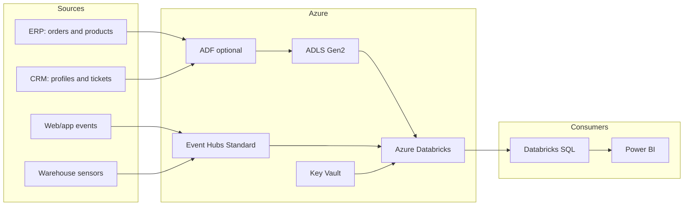
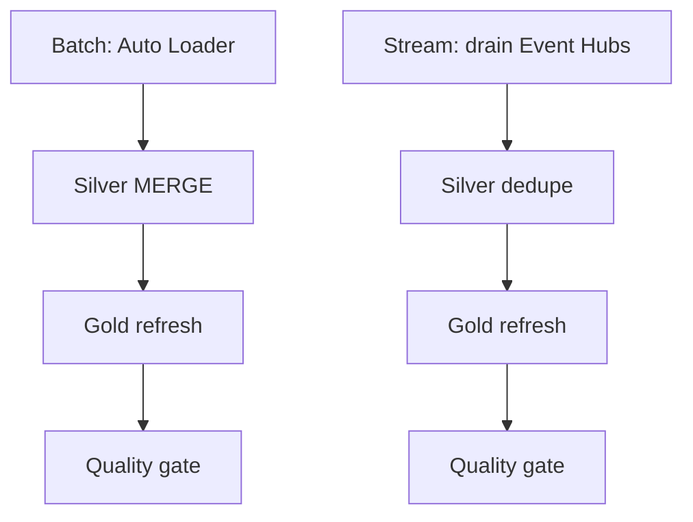

# Architecture and operating model

## Business goal

The fictional retailer needs one governed analytical platform for sales,
customer behavior, support operations, and warehouse conditions. Source systems
arrive at different speeds and shapes, but executives and analysts need consistent
KPIs with traceable lineage.

## Logical flow

| Stage | Input | Processing | Durable output |
|---|---|---|---|
| Landing | ERP/CRM CSV and JSONL | Upload or optional ADF metadata copy | Unity Catalog external volume on ADLS |
| Streaming ingress | Clickstream and IoT JSON | Event Hubs Standard Kafka endpoint | Event Hubs retained log |
| Bronze | Files and event messages | Minimal parsing plus source metadata | Append-only Delta tables |
| Silver | Bronze Delta | Cast, deduplicate, validate, quarantine, MERGE | Conformed Delta entities |
| Gold | Silver entities | SCD2, dimensions, facts and aggregations | BI-ready star schema and marts |
| Serving | Gold | Databricks SQL / Power BI semantic model | Reports and operational insights |

## Physical architecture

## Medallion responsibilities

### Bronze

- One table per source contract.
- No destructive cleanup.
- Raw streamed JSON is retained in `raw_payload`.
- `_ingested_at`, file name, Kafka partition/offset and message timestamp provide auditability.
- Auto Loader checkpoints provide exactly-once file discovery; Event Hubs remains at-least-once,
  so event IDs are deduplicated in Silver.

### Silver

- Data types and business enums are enforced.
- The latest source version wins for mutable ERP/CRM entities.
- Invalid rows are serialized into `ops.quarantine_records` with a reason.
- Delta `MERGE` makes reruns idempotent.
- `customers_enriched` conforms ERP identity with CRM attributes.

### Gold

- `fact_sales` grain: one order line.
- `dim_customer` uses SCD Type 2 to retain attribute history.
- Product and date are conformed dimensions.
- Marts are designed for a specific business decision, not merely copies of source tables.

## Orchestration

Two independent Databricks jobs support failure isolation:

Both use a single-node job cluster. The streaming job is not continuous: it uses
`availableNow`, finishes the currently available backlog, and terminates compute.
This trades higher latency for substantially lower demo cost.

## Reliability model

| Failure | Recovery behavior |
|---|---|
| Duplicate batch upload | Auto Loader checkpoint ignores an already processed file |
| Producer sends duplicate event | Silver `event_id` deduplication and Delta merge |
| Schema adds an unknown field | Bronze rescue column preserves unexpected data |
| Invalid business value | Row goes to quarantine; valid records continue |
| Task fails after Bronze | Rerun the job; downstream merges are idempotent |
| New customer attributes | SCD2 expires the prior current row and appends a new version |
| Quality violation | Results are persisted and job fails visibly |

## Security boundaries

- ADLS public blob access and shared-key authentication are disabled.
- Databricks uses an Azure Access Connector managed identity for ADLS.
- ADF uses its system-assigned managed identity.
- Event Hubs SAS keys are generated as least-privilege Listen and Send rules and stored in Key Vault.
- Databricks receives only the consumer connection string through a secret scope.
- The repository includes no live host, token, key or subscription identifier.

For a long-lived production environment, move Event Hubs authentication to Entra
OAuth, disable public network access, and add private endpoints and private DNS.

## Observability

- Databricks job task status and run history.
- `ops.data_quality_results` for check history.
- `ops.quarantine_records` for rejected source rows.
- `_source_file`, `_kafka_partition`, `_kafka_offset` for source traceability.
- Azure Log Analytics workspace as the central destination for later diagnostic settings.

## Performance choices

- Partition `fact_sales` and daily marts by integer date key.
- Keep dimensions unpartitioned because they are small.
- Use job compute, not an interactive all-purpose cluster.
- Run `OPTIMIZE`, statistics collection and safe seven-day `VACUUM` only after several loads.
- Use incremental ingest and idempotent merge instead of overwriting Bronze/Silver history.

